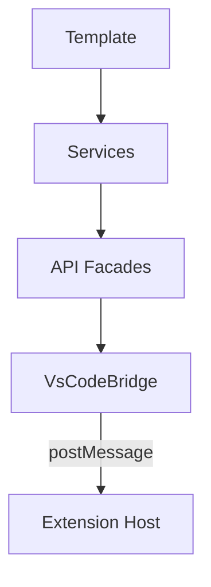

# Devora Code — Architektur-Übersicht

Devora Code ist eine VS Code Extension mit einem extensiblen Plugin-System. Der Core bringt das Fundament, Satelliten (Jira, GitHub, ...) kommen als Erweiterungen hinzu.

---

## Architektur

Satelliten sind eigenständige Extension-Pakete, die sich nach Core-Aktivierung anmelden. Der Core routet Commands an Core-Module oder Satelliten.

### Core-Module

| Modul | Beschreibung |
|-------|-------------|
| **WebviewModule** | Öffnet und verwaltet das Dashboard-Panel |
| **CommandRouter** | Unterscheidet Core-Commands von Satellite-Commands |
| **SatelliteService** | Verwaltet registrierte Satelliten |
| **SettingsService** | Liest Jira-Konfiguration aus VS Code |
| **NotificationService** | VS Code Popups |
| **LoggerService** | Schreibt Logs nach `~/devora-code-logs/` |

---

## Webview-Schichten

- **Services** — Domain-Logik pro Feature (IssueService, TimeTrackerService)
- **API Facades** — Interface/Implementierung, injiziert via DI
- **VsCodeBridge** — Single Point für alle Commands an die Extension

### State Management (NGXS)

| State | Inhalt |
|-------|--------|
| `SessionState` | Aktive Timer-Session |
| `IssueState` | Issue-Liste, selektiertes Issue, Focus-Task |
| `TimetrackerState` | Bookings, Periodendaten |

---

## Widget-System

Das Dashboard besteht aus Widgets — wiederverwendbare Blöcke mit Titel, Actions und Content. Jedes Widget registriert sich selbst über DI (Self-Provide-Pattern).

| Widget | Titel |
|--------|-------|
| Aktive Session | Timer mit Stopp-Button |
| Issue Selektor | Autocomplete für Issues |
| Aktuellster Issue | Focus-Task aus Jira |

Details: [docs/devora-code-webview/widgets.md](./docs/devora-code-webview/widgets.md)

---

## Lizenz

MIT – Ralf Hannuschka
