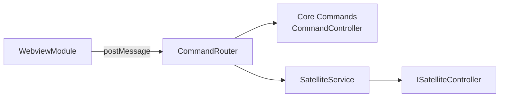
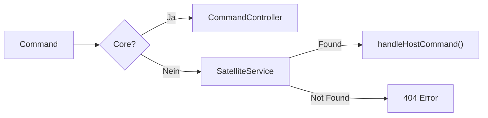

# @devora-code/core

Der Core ist der Einstiegspunkt der VSCode-Extension. Er initialisiert das DI-Container-System, öffnet das Webview und routet Commands an Core oder Satelliten.

---

## Installation

```json
{
  "dependencies": {
    "@devora-code/core": "*"
  }
}
```

Bauen mit `vite build`.

---

## Entry Point: activate()

```typescript
export async function activate(context: vscode.ExtensionContext) {
  // 1. DI-Container registrieren
  container.registerInstance(EXTENSION_CONTEXT_TOKEN, context);

  // 2. Webview Command registrieren
  vscode.commands.registerCommand("devora-code.openWebview", () => {
    container.resolve(WebviewModule).openDashboard();
  });

  // 3. Satellite Service laden
  const satelliteService = container.resolve(SatelliteService);

  return {
    registerSubModule: (satellite) => {
      satelliteService.registerSatellite(satellite);
    },
  };
}
```

### Aktivierungsschritte

1. **tsyringe** Container initialisiert (via `reflect-metadata`)
2. **Core-Module** werden importiert (Logger, Timetracker) — das registriert automatisch die Commands via `@RegisterCommand`
3. **Satellite Service** wird aufgelöst
4. **Webview Command** wird bei VSCode registriert
5. **`registerSubModule`** zurückgegeben — Satelliten-Extensions rufen das auf

---

## Architecture



---

## CommandRouter

Der zentraler Kommandos-Router. Unterscheidet zwischen Core-Commands und Satellite-Commands.

```typescript
class CommandRouter {
  private static readonly CORE_COMMANDS = new Set([
    "timetracker:start-tracking",
    "timetracker:stop-tracking",
    "timetracker:get-active-timer",
    "timetracker:get-month",
    "timetracker:get-period",
  ]);

  execute(command): CommandResponse | CommandErrorResponse
}
```

### Routing-Logik



- **Core-Commands** → direkt an `CommandController` (von `@devora-code/sdk`)
- **Satellite-Commands** → an registrierten Satelliten delegieren
- **Unbekannte Commands** → `CommandErrorResponse` mit code 404

---

## SatelliteService

```typescript
@singleton()
class SatelliteService {
  registerSatellite(satellite: ISatelliteController): void
  getSatelliteForCommand(type): ISatelliteController | null
  hasSatelliteForCommand(type): boolean
}
```

Jeder Satellit bringt seine Liste unterstützter Commands mit. Bei der Registrierung werden alle Commands in einer Dispatch-Tabelle eingetragen.

```typescript
// Beispiel: Jira-Satellit registrieren
satelliteService.registerSatellite({
  id: 'jira',
  commands: ['jira:fetch-issues', 'jira:get-details', 'jira:start-session'],
  async handleHostCommand(command) {
    // Command ausführen
  },
});
```

---

## WebviewModule

Öffnet und verwaltet das Devora Code Dashboard als Webview-Panel.

```typescript
@singleton()
class WebviewModule {
  private activePanel: WebviewPanel | undefined;

  openDashboard(): void {
    // 1. Panel anzeigen (doppelter Klick → reveal, nicht neu)
    // 2. DevoraCodeWebview auflösen
    // 3. Message-Listener registrieren
    // 4. Cleanup-Listener für Panel-Close
  }
}
```

### Message-Flow

```
Webview (Browser) → postMessage(Command) → WebviewModule
WebviewModule → CommandRouter.execute(command) → response
WebviewModule → postMessage(response) → Webview
```

Bei Error: `NotificationService.showError()` mit Command-Typ und Error-Message.

---

## DevoraCodeWebview (Panel Provider)

Erstellt das tatsächliche Webview-Panel und rendert die HTML.

```typescript
class DevoraCodeWebview {
  show(): WebviewPanel {
    // 1. HTML aus dist/browser/index.html laden
    // 2. Assets-URIs in Webview-URIs umwandeln
    // 3. CSP-Meta-Tag injecten
    // 4. Panel zurückgeben
  }
}
```

### CSP-Restrictions

```
default-src 'none';
script-src <webview-uri> 'unsafe-inline' 'unsafe-eval';
style-src <webview-uri> 'unsafe-inline';
font-src <webview-uri>;
img-src <webview-uri> data:
```

---

## Core-Module

### SettingsService

```typescript
@singleton()
class SettingsService {
  get(key: SettingKey): unknown
}
```

**SettingKeys:**

| Key | Typ | Beschreibung |
|-----|-----|-------------|
| `JIRA_API_URL` | string | Base URL der Jira REST API |
| `JIRA_API_TOKEN` | string | API Token für Authentifizierung |
| `JIRA_USER_NAME` | string | Benutzername/E-Mail |
| `JIRA_PROJECT_KEY` | string | Jira Projekt-Schlüssel |
| `ISSUE_TYPE_MAPPING` | IssueTypeMapping | Mapping von Jira-Tickettypen |
| `STATUS_MAPPING` | StatusMapping | Mapping von Jira-Status |

**Leselogik:**

1. `process.env[key]` (Entwicklung/CI)
2. `workspace.getConfiguration("devora-code").get(key)` (VSCode-Einstellungen)

---

### NotificationService

```typescript
@singleton()
class NotificationService {
  showError(message: string, error?: Error): void
  showWarning(message: string): void
  showInfo(message: string): void
}
```

Wrapper um VSCode `window.showErrorMessage/warningMessage/informationMessage`.

---

### LoggerService

File-based Logger. Schreibt JSON-lines in `~/devora-code-logs/devora-code.log`.

```typescript
@singleton()
class LoggerService {
  debug(message: string, context?: string): void
  info(message: string, context?: string): void
  warn(message: string, context?: string): void
  error(message: string, context?: string): void
}
```

**Logging-Format:**

```json
{"timestamp":"2025-01-15T10:30:00Z","level":"info","message":"[Timetracker] Session started"}
```

**Wichtig:** Der Logger fängt eigene Errors ab — er darf den Betrieb nicht stören.

---

### BaseException

```typescript
class BaseException extends Error {
  protected readonly errorCode: number = 1;
  get code(): number
  get error(): Error | undefined
}
```

Abstrakte Basisklasse. `errorCode` wird im `CommandController` in `CommandErrorResponse.code` transformiert.

---

### CommandModule (Logger)

Der Logger exportiert ein `SendLogCommand` für Logs vom Webview:

```typescript
@RegisterCommand('[Logger]: send')
export class SendLogCommand implements CommandHandler<void> {
  constructor(private command: Command) {}

  async execute(): Promise<void> {
    // Log-Eintrag vom Webview empfangen und in Log-Datei schreiben
  }
}
```

---

### TimetrackerModule

Enthält die Core-Commands für den Timer und die Perioden-Abfragen.

**Commands:**

| Command | Handler | Beschreibung |
|---------|---------|-------------|
| `timetracker:start-tracking` | `StartTrackingCommand` | Timer starten |
| `timetracker:stop-tracking` | `StopTrackingCommand` | Timer stoppen |
| `timetracker:get-active-timer` | `GetActiveTimerCommand` | Aktuellen Timer abfragen |
| `timetracker:get-month` | `GetMonthCommand` | Monatsdaten laden |
| `timetracker:get-period` | `GetPeriodCommand` | Periodendaten laden |

**Domain-Service:** `TimeTrackerService` — eigentliche Timer-Logik.
**Repository:** `TimesheetRepository` — persistente Speicherung.
