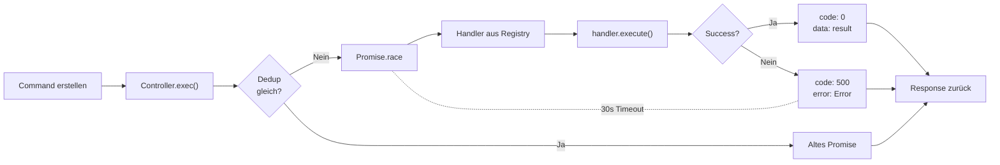

# @devora-code/sdk

Plain npm-Package. Gebaut mit `tsc` — kein Vite.

---

## Installation

```json
{
  "dependencies": {
    "@devora-code/sdk": "*"
  }
}
```

---

## Exports

| Export | Inhalt |
|--------|--------|
| `@devora-code/sdk/command` | Command-Pattern (Controller, Registry, Decorator, Factory) |
| `@devora-code/sdk/core` | Satellite-Vertrag (ISatelliteController) |

---

## CommandController

Singleton. Zentrale Klasse für Command-Execution.

```typescript
@singleton()
export class CommandController {
  async exec<TCommand extends Command>(command: Command): Promise<CommandResponse | CommandErrorResponse>
}
```

### Features

- **Deduplication** — gleiche Command-Payload teilt sich ein Promise (SHA256-Hash)
- **Timeout** — 30 Sekunden, danach `CommandErrorResponse`
- **Error Handling** — jeder Error → `CommandErrorResponse` mit code 500
- **Response-ID** — Response trägt die original `command.id`

### Ablauf



1. Command erstellen → `createCommand()` oder manuell
2. `CommandController.exec(command)` aufrufen
3. Deduplication prüft `type + SHA256(payload)`
4. Handler aus Registry holen → `new Handler(command).execute()`
5. Response: `CommandResponse` (code 0) oder `CommandErrorResponse` (code 500)

---

## CommandRegistry

Singleton. Speichert die Zuordnung Command-Typ → Handler-Konstruktor.

```typescript
@singleton()
export class CommandRegistry {
  register(type: string, ctor: CommandHandlerConstructor): void
  get(type: string): CommandHandlerConstructor
}
```

Beim Registrieren: `Handler registriert: "issues:list"` in der Debug-Console.

---

## @RegisterCommand Decorator

Automatisiert die Registrierung im `CommandRegistry`.

```typescript
export function RegisterCommand(domain: string) {
  return function (ctor: CommandHandlerConstructor<any>) {
    const registry = container.resolve(CommandRegistry);
    registry.register(domain, ctor);
  };
}
```

Der Decorator feuert beim **Import** der Klasse — kein manueller Registry-Eintrag nötig.

### Handler erstellen

```typescript
@RegisterCommand("issues:list")
export class ListIssuesHandler implements CommandHandler<IssueList> {
  async execute(): Promise<IssueList> {
    const repo = container.resolve(IssueRepository);
    return await repo.getIssues();
  }
}
```

### Handler mit Payload

```typescript
@RegisterCommand("issues:get-detail")
export class GetIssueDetailHandler implements CommandHandler<IssueDetail> {
  constructor(private command: { type: string; payload: { key: string } }) {}

  async execute(): Promise<IssueDetail> {
    const repo = container.resolve(IssueRepository);
    return await repo.getIssueByKey(this.command.payload.key);
  }
}
```

Der Constructor bekommt den typisierten Command übergeben.

---

## CommandFactory

```typescript
function createCommand<TCommand>(type: string, payload?: any): CommandInstance<TCommand>
```

Erzeugt typisierte Command-Instanzen:

```typescript
const cmd = createCommand("issues:list");
// → { id: "uuid", type: "issues:list", payload: undefined }

const cmd2 = createCommand("issues:get-detail", { key: "KVQAIP-1" });
// → { id: "uuid", type: "issues:get-detail", payload: { key: "KVQAIP-1" } }
```

---

## Error Response

```typescript
interface CommandResponse {
  id: string;
  code: 0;
  data?: any;
}

interface CommandErrorResponse {
  id: string;
  code: number;
  error: Error;
}

function isErrorResponse(response): response is CommandErrorResponse
```

### Verwendung

```typescript
import { CommandController, createCommand, isErrorResponse } from "@devora-code/sdk/command";

const result = await commandController.exec(cmd);

if (isErrorResponse(result)) {
  console.error("Fehler:", result.error.message);
  return;
}

// result.code === 0
console.log("Erfolg:", result.data);
```

### Error Codes

| Code | Bedeutung |
|------|-----------|
| 0 | Success |
| 500 | Generic Error / Timeout |
| 404 | Unknown Command (Core) |

---

## Deduplication

Wenn der **gleiche Command** mit **gleichen Payloads** mehrfach aufgerufen wird, läuft er nur einmal:

```typescript
const p1 = commandController.exec(cmd1);
const p2 = commandController.exec(cmd2);

// Gleicher type + Payload → selbes Promise (nur ein Handler-Aufruf)
// Beide bekommen ihre eigene response.id zurück
```

---

## Satelliten

Siehe [tutorial.md](../devora-code-satellites/tutorial.md) für ISatelliteController und wie man eine neue Satellite-Extension baut.
