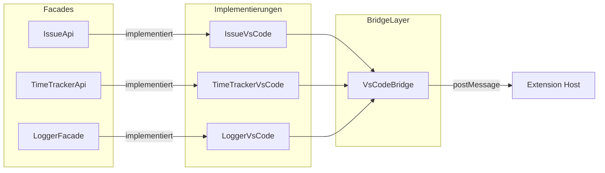
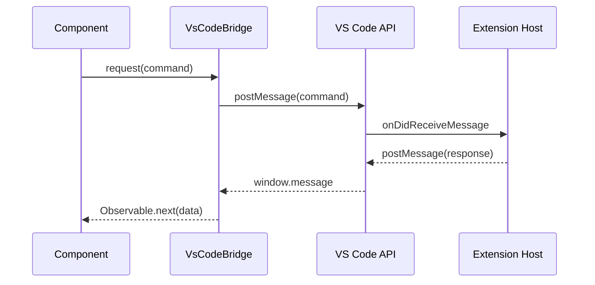

# Kommunikation

Schnittstelle zwischen Webview und VS Code Extension Host.

---

## VsCodeBridge

Zentraler Service für bidirektionale Kommunikation per `postMessage`.

### Architektur



### Command-Response-Flow



---

## API-Facades

### IssueApi

```typescript
export interface IssueApi {
  getIssueByKey(key: string): Observable<IssueDetail | null>;
  list(): Observable<IssueList>;
  getCurrentInProgressTask(): Observable<FocusedIssue | null>;
}
```

### TimeTrackerApi

```typescript
export interface TimeTrackerApi {
  startTracking(issueKey: string): Observable<TimeEntry>;
  stopTracking(): Observable<{ duration: number; date: string; id: string }>;
  getPeriod(startDate: string, endDate?: string): Observable<TimeEntryList | undefined>;
  getActiveTimer(): Observable<TimeEntry | null>;
  getMonth(month: string): Observable<Record<string, TimeEntry[]>>;
}
```

### LoggerFacade

```typescript
export interface ILoggerFacade {
  debug(message: string, context?: string): void;
  info(message: string, context?: string): void;
  warn(message: string, context?: string): void;
  error(message: string, context?: string): void;
}
```

---

## DI-Konfiguration

```typescript
{ provide: IssueApi, useClass: IssueVsCode },
{ provide: TimeTrackerApi, useClass: TimeTrackerVsCode },
{ provide: LoggerFacade, useClass: LoggerVsCode },
```

---

## Browser-Modus

Bei `ng serve` schaltet `VsCodeBridge` automatisch in den Mock-Modus:

- Commands → `console.log('[VsCodeBridge Mock]', msg)`
- `request()` → sofort `of(null)` zurück
- Keine Hänger, UI vollständig testbar ohne VS Code

---

## Error Handling

| Error | Herkunft | Behandlung |
|-------|----------|-----------|
| `response.code > 0` | Extension | `Error(response.error.message)` wird geworfen |
| Timeout | Extension | `TimeoutException` nach 30 Sekunden |
| Kein `acquireVsCodeApi` | Browser | Mock-Modus: Console.log + sofort `null` |

