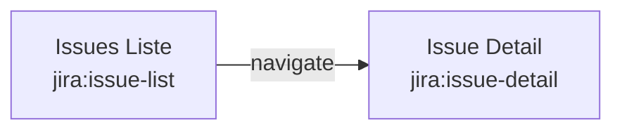
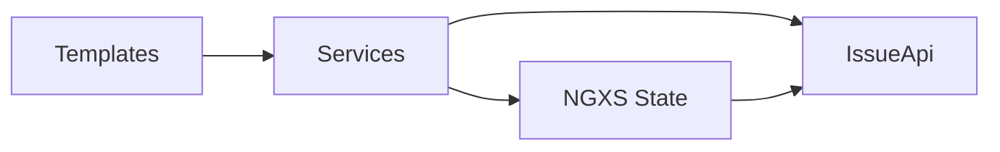
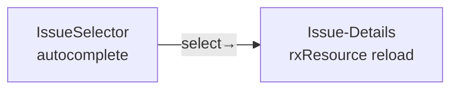

# Issue-Feature

Das Issue-Feature verwaltet Issues: Liste, Detail-Ansicht, Selektor und Widgets.

---

## Routes



| Route | Selector | Component |
|-------|----------|-----------|
| `jira:issue-list` | `jira-issues-list` | `IssueIssuesListComponent` |
| `jira:issue-detail` | `jira-issue-details` | `IssueDetailsComponent` |

Routes definiert in `static/routes.ts` als `PortalRoute[]` mit dynamischem `import()`.

---

## Layers



---

## State: IssueState

```typescript
export interface IssueStateModel {
  issues: IssueList | null;
  selectedIssue?: IssueListItem;
  currentFocusTask: FocusedIssue | null;
}
```

NGXS-State mit drei Properties:

- **issues** — Liste aller Issues (initialisiert via `ngxsOnInit`)
- **selectedIssue** — aktuell selektiertes Issue (über Autocomplete oder Widget)
- **currentFocusTask** — aktuellster Issue aus Jira Activity Stream

### Actions

| Action | Beschreibung |
|--------|-------------|
| `FetchTasks` | Issues laden, optional mit `force` |
| `FetchCurrentFocusedTask` | Activity Stream Issue laden |
| `SelectIssue` | Issue markieren (per Selector oder Widget) |

### Selectors

```typescript
class IssueStateSelectors {
  static issues(ctx) → IssueList | null
  static selectedIssue(ctx) → IssueListItem | undefined
  static currentFocusedTask(ctx) → FocusedIssue | null
}
```

---

## Services

### IssueService

```
IssueService
├── list (rxResource)    → Issue-Liste mit Tracking-Highlight (isTracking)
├── suche (Signal)       → Filtersuche (Key + Summary)
├── getDetails(key)      → Issue-Details via IssueApi
├── startSession(issue)  → StartSession dispatchen
└── stopSession()        → StopSession dispatchen
```

`list` ist ein `rxResource` das die Issues aus dem Store liest und den Issue mit aktivem Timer mit `isTracking: true` markiert. Die clientseitige Suche filtert Key und Summary.

### IssueSelectorService

```
IssueSelectorService
├── availableIssues      → Alle Issues minus aktuell getracktes Issue
├── filteredIssues       → availableIssues + Filter
├── selectIssue(issue)   → SelectIssue dispatchen
├── startIssue()         → StartSession mit selectedIssue dispatchen
└── setFilter(filter)    → Filter-Set
```

Die verfügbaren Issues schließen das aktuell getrackte Issue aus — man kann kein Issue selektieren das bereits aktiv ist.

---

## Komponenten

### IssuesListe (`jira-issues-list`)

CDK Table mit Spalten: Key, Summary, Priority, Actions.

- Suchfeld oben (`model<string>`) → filtert über `IssueService.suche`
- Klick auf Issue-Row → `gotoDetails()` → Navigation zu `jira:issue-detail`
- Play/Pause-Button pro Zeile → Session starten/stopen
- Highlight des Issues mit aktivem Timer via `isTracking`

```
┌────────────────────────────────────────────┐
│  [Suche ............ 🔍]                    │
├──────────┬──────────────┬────────┬─────────┤
│ KEY      │ SUMMARY      │ PRIORITY│ ACTIONS│
├──────────┼──────────────┼────────┼─────────┤
│ KVQAIP-1 │ Screen Design │ High   │ ▶ ⏹    │ ← isTracking
│ KVQAIP-2 │ Login Page   │ Medium │ ▶      │
└──────────┴──────────────┴────────┴─────────┘
```

### Issue-Details (`jira-issue-details`)

Zeigt Issue-Details + eingebetteten Issue-Selector.

- Läd Details via `rxResource` aus `RouteParams.key` oder `activeSession.issueKey`
- `IssueSelectorComponent` eingebettet — beim Selektieren wird Detail neu geladen
- Live-Timer wenn Issue in aktiver Session



### Issue-Selector (`devora-code-issue-selector`)

Wiederverwendbares Autocomplete-Widget.

- **input** `issueKey` — zeigt aktuelles Issue im Input an
- **output** `selected` — Emit bei Auswahl (Parent entscheidet: Widget → navigate, Details → reload)
- Filtert über Key und Summary

```typescript
@Component({
  selector: 'devora-code-issue-selector',
  providers: [IssueSelectorService],
})
export class IssueSelectorComponent {
  readonly issueKey = input<string | null>(null);
  readonly selected = output<IssueListItem>();
}
```

---

## Widgets

| Widget | Selector | Titel |
|--------|----------|-------|
| **Issue Selektor Widget** | `devora-code-issue-selector-widget` | "Issue Selektor" |
| **Aktuellster Issue** | `devora-code-current-focus-task` | "Aktuellster Issue" |

### Issue Selector Widget

Autocomplete im Widget-Styling. Selektiertes Issue → Navigation zu `jira:issue-detail`.

### Aktuellster Issue

Zeigt `currentFocusTask` aus dem Store. Nutzt `DevoraCodeTeaserComponent` für das Layout.
