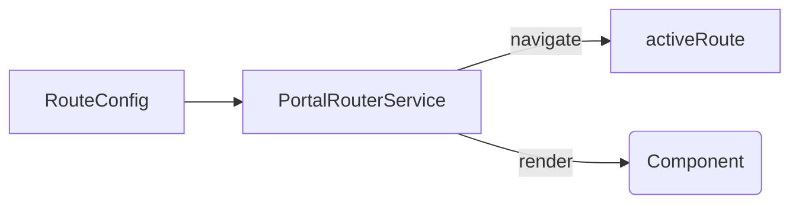

# Routing

Devora Code nutzt einen eigenen `PortalRouterService` basierend auf Angular CDK Portal. Keine Router-Outlet, sondern dynamisches Ersetzen des View-Contents.

---

## Architektur



### So funktioniert's

1. **Route-Konfiguration** — `routerConfig` als `PortalRoute[]` in `app.config.ts`
2. **Navigation** — `navigate(path, params?)` setzt ein Signal `activeRoute`
3. **Resource** — `activeView` reagiert auf Signal-Änderung und lädt die Komponente
4. **Lazy Loading** — `component()` ist ein `() => Promise<ComponentType>` → Dynamic Import
5. **Injector** — pro Route wird ein neuer Child-Injector erstellt, RouteParams werden injiziert
6. **Portal** — `ComponentPortal` wird zurückgegeben → Parent-Template rendert den Content

---

## API

| Methode | Beschreibung |
|---------|-------------|
| `navigate(path, params?)` | Navigation zu einer Route |
| `activeView()` | Resource → liefert aktiven `ComponentPortal` |
| `getCurrentPath()` | Gibt aktuellen Pfad zurück (für aktive Nav-Links) |

### RouteParams

```typescript
inject<RouteParams>() // → { key: 'ABC-123' }
```

---

## Route-Definition

```typescript
export interface PortalRoute {
  path: string;
  default?: boolean;
  component: () => Promise<ComponentType<unknown>>;
}
```

- `component` ist lazy — wird nur geladen wenn die Route betreten wird
- `params` werden an die Komponente injiziert (als `RouteParams` Token)

---

## Template (Parent)

Der Parent rendert den aktiven View per `cdkPortal`:

```html
<ng-container *cdkPortalOutlet="portalRouter.activeView()"></ng-container>
```

---

## Feature-Routen

Features exportieren ihre eigenen Routen als `routes[]`:

```typescript
// features/issue/feature-shell/index.ts
export { routes } from './static/routes';

// features/issue/feature-shell/static/routes.ts
export const routes: PortalRoute[] = [
  { path: 'jira:issue-list', component: () => import('../components/issues-list.component') },
  { path: 'jira:issue-detail', component: () => import('../components/issue-details.component') },
];
```

Im Parent (app.config.ts) werden sie per Spread zusammengeführt:

```typescript
import { routes as jiraRoutes } from '@/feature/issue/feature-shell';
import { routes as timetrackerRoutes } from '@/feature/timetracker/feature-shell';

export const routerConfig: PortalRoute[] = [
  { path: 'dashboard', component: ... },
  ...jiraRoutes,
  ...timetrackerRoutes,
];
```

