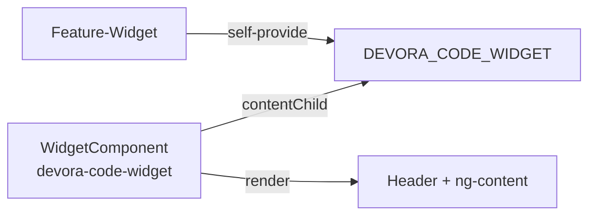

# Widget-System

Das Widget-System bietet ein wiederverwendbares Layout-Chrome (Header, optionale Action-Icons) für Feature-Widgets. Das Feature-Widget liefert den Content, der Widget-Host liefert das统一的 Layout.

---

## Architektur

Das Widget-System verwendet das Self-Provide-Pattern: das Feature-Widget stellt sich selbst als Implementierung seines eigenen Interfaces über DI bereit — keine Registry, kein Eintrag, keine Abhängigkeit des Hosts auf das konkrete Widget.



Beispiel — `ActiveSessionWidgetComponent`:

```typescript
@Component({
  selector: 'devora-code-active-session',
  encapsulation: ViewEncapsulation.None,
  providers: [
    { provide: DEVORA_CODE_WIDGET, useExisting: ActiveSessionWidgetComponent },
  ],
})
export class ActiveSessionWidgetComponent implements DevoraCodeWidget {
  readonly title = 'Aktive Session';

  readonly actions: DevoraCodeWidgetAction[] = [
    { key: '[Session]: stop session', icon: 'stop_circle' },
  ];

  actionDispatched(action: DevoraCodeWidgetAction): void {
    if (action.key === '[Session]: stop session') {
      this.stopSession();
    }
  }
}
```

---

## Kontrakt: DevoraCodeWidget

Jedes Widget-Feature muss diese Schnittstelle implementieren:

```typescript
export interface DevoraCodeWidget {
  readonly title: string;
  readonly actions?: DevoraCodeWidgetAction[];
  actionDispatched?(action: DevoraCodeWidgetAction): void;
}
```

Die Action ist typisiert über:

```typescript
export interface DevoraCodeWidgetAction {
  readonly key: string;
  readonly icon: string;
}
```

- **`title`** — statische Zeichenkette, angezeigt im Header
- **`actions`** — optionale Toolbar-Aktionen, gerendert als Icon-Buttons
- **`actionDispatched`** — optionaler Callback bei Icon-Button-Klick

---

## Widget erstellen

Ein Widget besteht aus zwei Schritten:

### Schritt 1: Component mit Interface + Provider

```typescript
@Component({
  selector: 'devora-code-issue-selector',
  templateUrl: './issue-selector-widget.component.html',
  encapsulation: ViewEncapsulation.None,
  providers: [
    { provide: DEVORA_CODE_WIDGET, useExisting: IssueSelectorWidget },
  ],
})
export class IssueSelectorWidget implements DevoraCodeWidget {
  readonly title = 'Issue suchen';
}
```

Fertig. Die zwei verpflichtenden Zutaten sind:

1. `implements DevoraCodeWidget` mit mindestens `title`
2. `providers` mit dem Self-Provide-Eintrag

### Schritt 2: Exportieren

```typescript
// im Feature-Module oder barrel export
export * from './issue-selector.component';
```

Mehr gibt's nicht. Kein Registry-Eintrag, keine Konfigurationsdatei, kein Factory-Pattern.

---

## Widgets im Dashboard

| Widget | Selector | Titel | Aktionen |
|--------|----------|-------|----------|
| **Aktive Session** | `devora-code-active-session` | "Aktive Session" | Stop-Button (stopt Timer) |
| **Issue Selektor** | `devora-code-issue-selector` | "Issue Suche" | — |
| **Aktuellster Issue** | `devora-code-current-focus-task` | "Aktuellster Issue" | — |

### Aktive Session

Zeigt den aktuell aktiven Timer mit Live-Elapsed-Counter. Action: Stop-Button → `StopSession` Action.

### Issue Selektor

Autocomplete zum Suchen von Issues (Key + Summary). Navigiert zur Issue-Details-Route.

### Aktuellster Issue

Zeigt den aktuellsten fokussierten Issue aus dem Store.
